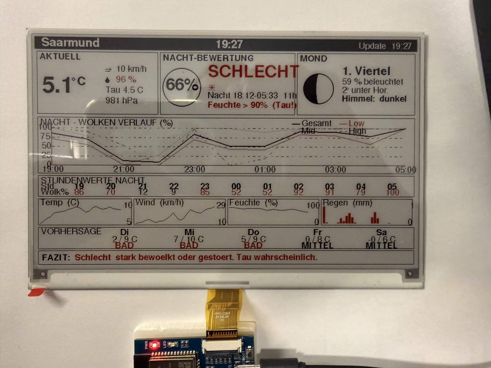

<p align="center">
  <picture>
    <source media="(prefers-color-scheme: dark)" srcset="docs/images/hero-dark.svg">
    <source media="(prefers-color-scheme: light)" srcset="docs/images/hero-light.svg">
    
  </picture>
</p>

<p align="center">
  
  
  
  
  
  <a href="LICENSE"></a>
</p>

<p align="center">
  <a href="#-die-zwei-modi"><b>Modi</b></a> ·
  <a href="#-funktionen"><b>Funktionen</b></a> ·
  <a href="#-hardware"><b>Hardware</b></a> ·
  <a href="INSTALL.md"><b>Installation</b></a> ·
  <a href="#%EF%B8%8F-konfiguration"><b>Konfiguration</b></a> ·
  <a href="#%EF%B8%8F-roadmap"><b>Roadmap</b></a> ·
  <a href="CONTRIBUTING.md"><b>Mitmachen</b></a>
</p>

<p align="center">
  <b>Ein E-Ink-Display an der Wand, das weiß, ob heute Nacht etwas geht – und was gerade am Teleskop passiert.</b><br>
  Ein ESP32 mit Waveshare-7,5″-E-Paper zeigt tagsüber das Astro-Wetter für deinen Standort.<br>
  Sobald <a href="https://nighttime-imaging.eu/">N.I.N.A.</a> eine Sequenz fährt, wechselt es von selbst auf Live-Telemetrie deiner Session.
</p>

<p align="center">
  
  <br><sub>Das echte Display im WEATHER-Modus – Waveshare 7,5″ V3, Schwarz/Weiß/Rot</sub>
</p>

---

## 🔁 Die zwei Modi

<p align="center">
  <picture>
    <source media="(prefers-color-scheme: dark)" srcset="docs/images/modi-dark.svg">
    
  </picture>
</p>

Ein Gerät, zwei Code-Pfade. Zu Beginn jedes Zyklus prüft AstroOyInk, ob die
N.I.N.A. Advanced API erreichbar ist **und** eine Sequenz läuft.

| | ☁️ **WEATHER** | 🔭 **SESSION** |
|---|---|---|
| **Wann** | Standard – immer, wenn keine Session läuft | N.I.N.A. erreichbar und Sequenz aktiv |
| **Quellen** | Open-Meteo, 7Timer!, open-notify, Mond lokal | N.I.N.A. Advanced API v2 (Port 1888) |
| **Takt** | stündlich, dazwischen Deep-Sleep | alle 5 min, Gerät bleibt wach |
| **Zurück** | – | automatisch, sobald N.I.N.A. weg ist |

## ✨ Funktionen

<table>
<tr>
<td width="50%" valign="top">

### ☁️ WEATHER-Modus

- ⭐ **Nacht-Bewertung** aus gewichteter Wolkendecke<br><sub>Low 0,5 · Mid 0,3 · High 0,2 → GUT / MITTEL / SCHLECHT</sub>
- 🕘 **Echtes Nachtfenster** – Sonnenuntergang +2 h bis Sonnenaufgang −2 h
- 🌙 **Mond nach Meeus**, lokal berechnet: Phase, Beleuchtung, Höhe, Himmelsaufhellung
- 📈 **Wolken-Verlauf** der Nacht (Gesamt/Low/Mid/High)
- 🪐 **Seeing & Transparenz** von 7Timer! als rote Kurven im Chart
- 🛰️ **ISS-Überflüge** direkt in der Stundentabelle markiert
- ⚠️ **Wind- und Tau-Warnung** ab 25 km/h bzw. 90 % Feuchte
- 📊 Mini-Charts (Temp, Wind, Feuchte, Regen) und **5-Tage-Vorschau**

</td>
<td width="50%" valign="top">

### 🔭 SESSION-Modus

- 📋 **Sequenz:** Name, Target i/n, Sub i/n, Restzeit, Status
- 🎯 **Objekt:** Höhe und Azimut
- 📷 **Kamera:** Name, Filter, Belichtungszeit, HFR
- 🧭 **Guiding:** RMS RA/Dec/Total mit Status OK / WARN / LOST
- 🌐 **Mount:** RA/Dec, Pier-Seite, Meridian-Flip-Countdown
- 🚨 **Warnungen** rot hervorgehoben: RMS ≥ 1,0″, Flip < 10 min, Slewing, Pause

### 🧰 Rund ums Gerät

- 📶 **WiFiManager** – Captive Portal, alle Einstellungen ohne Re-Flash
- 📤 **OTA-Updates** – 30-s-Fenster nach jedem WLAN-Connect
- 🌡️ **BME280** – Innentemperatur, Feuchte, Luftdruck
- 🔋 **Akkuanzeige** im Header, USB-Erkennung
- 💤 **Deep-Sleep** zwischen den Updates

</td>
</tr>
</table>

> [!NOTE]
> **Drei Farben, kein Grün.** Das Panel kann nur Schwarz, Weiß und Rot. „Gute“
> Zustände zeigt AstroOyInk deshalb mit Sternen, Rahmen und fetter Schrift –
> Rot ist für Warnungen reserviert. Für reine B/W-Panels gibt es
> `DISPLAY_HAS_RED 0`.

## 🔩 Hardware

| Komponente | Modell | Hinweis |
|---|---|---|
| Mikrocontroller | ESP32-WROOM-32 | getestet mit dem Waveshare ESP32 e-Paper Driver Board |
| Display | Waveshare **7,5″ E-Paper V3**, B/W/R, 800×480 | Treiber `GxEPD2_750c_Z08` |
| Stromversorgung | USB 5 V | Refresh zieht kurz bis 200 mA |
| *optional* | BME280 (I²C) | Innenklima im AKTUELL-Block |
| *optional* | LiPo-Akku + Spannungsteiler an GPIO 34 | Akkuanzeige im Header |
| *optional* | Bilderrahmen 7×5″ | für die Wand |

<details>
<summary><b>Pinbelegung Display</b></summary>

| Signal | BUSY | RST | DC | CS | SCK | MOSI |
|---|---|---|---|---|---|---|
| GPIO | 25 | 26 | 27 | 15 | 13 | 14 |

</details>

> [!TIP]
> Ein voller Drei-Farben-Refresh dauert auf dem V3-Panel **25–30 Sekunden**.
> Das Flackern dabei ist normal.

## 🚀 Schnellstart

Die ausführliche Anleitung steht in **[INSTALL.md](INSTALL.md)**. Kurzfassung:

1. **Arduino IDE 2.x** und das **ESP32-Boardpaket** (≥ 2.0.14) installieren
2. Bibliotheken über den Library Manager: `GxEPD2`, `Adafruit GFX`, **`ArduinoJson 7.x`**, `WiFiManager` (tzapu)
3. Board **„ESP32 Dev Module“** wählen, `AstroOyInk.ino` öffnen und flashen
4. Mit dem WLAN **`AstroOyInk-XXXXXX`** verbinden (der Name steht auch auf dem Display) und im Portal WLAN, Standort und optional den N.I.N.A.-Host eintragen
5. Fertig – das erste Dashboard erscheint nach etwa einer Minute

## ⚙️ Konfiguration

Alles lässt sich im **WiFiManager-Portal** einstellen. Die Defaults für die
Ersteinrichtung stehen in `config.h`:

```cpp
// Standort
#define LOCATION_NAME   "Berlin"
#define LOCATION_LAT    52.5200f
#define LOCATION_LON    13.4050f
#define TIMEZONE_POSIX  "CET-1CEST,M3.5.0,M10.5.0/3"

// Update-Intervalle
#define REFRESH_INTERVAL_S          3600UL  // WEATHER: 1 Stunde, Deep-Sleep
#define SESSION_REFRESH_INTERVAL_S   300UL  // SESSION: 5 Minuten, wach

// Display: 1 = Schwarz/Weiss/Rot (Standard), 0 = nur B/W
#define DISPLAY_HAS_RED  1

// Guiding-Warnschwelle im SESSION-Modus
#define GUIDING_WARN_RMS_ARCSEC  1.0f

// Akkuanzeige (optionaler LiPo)
#define BATT_ENABLED         1
#define BATT_ADC_PIN         34
#define BATT_VOLTAGE_DIVIDER 2.0f
```

### SESSION-Modus aktivieren

1. In N.I.N.A. das Plugin **Advanced API** installieren und aktivieren (Port 1888).
2. Im Portal das Feld **„N.I.N.A. Host“** ausfüllen – oder in `config.h`:

   ```cpp
   #define NINA_HOST_DEFAULT   "nina-pc.local"   // oder IP, z. B. "192.168.1.42"
   #define NINA_PORT_DEFAULT   1888
   ```

3. Sequenz starten. Beim nächsten Zyklus wechselt das Display von selbst.

## 🖼️ Display-Layout

<details>
<summary><b>WEATHER-Modus</b> (800 × 480)</summary>

```
┌─ Saarmund ────────────── 22:41 ────────── [### ] 72 %  Update 22:41 ─┐
│ AKTUELL            │ NACHT-BEWERTUNG       │ MOND                    │
│  3.7 C    6 km/h   │  ( 8% )  GUT          │  (  Zun. Sichel         │
│           78 %     │          *****        │     25 % beleuchtet     │
│  IN: 21 C  45 %    │  Nacht 22:17-03:54    │     Himmel: dunkel      │
├────────────────────┴───────────────────────┴─────────────────────────┤
│ NACHT - WOLKEN-VERLAUF (%)      Gesamt / Low / Mid / High + Seeing   │
├──────────────────────────────────────────────────────────────────────┤
│ STUNDENWERTE NACHT   Std / Wolk% / ISS                               │
├──────────────────────────────────────────────────────────────────────┤
│ Temp │ Wind │ Feuchte │ Regen      (Mini-Charts 24 h)                │
├──────────────────────────────────────────────────────────────────────┤
│ VORHERSAGE   Mi   Do   Fr   Sa   So                                  │
└──────────────────────────────────────────────────────────────────────┘
```

</details>

<details>
<summary><b>SESSION-Modus</b> (800 × 480)</summary>

```
┌─ Saarmund ────────────── 23:12 ───────────────────── [### ] 72 % ─┐
│ SEQUENZ  M31-LRGB   Target 1/3   Sub 42/120   Restzeit 2:35       │
│ Status: Imaging     Alt 58 / Az 112                               │
├──────────────────────┬──────────────────────┬─────────────────────┤
│ KAMERA               │ GUIDING              │ MOUNT               │
│ ZWO ASI2600MM        │ RA   0.42"           │ EQ6-R Pro           │
│ Filter: L            │ Dec  0.38"           │ RA/Dec              │
│ 180 s                │ Tot  0.57"           │ Alt/Az              │
│ HFR 2.1              │ [Guiding OK]         │ Pier: East          │
│                      │                      │ Flip in 1:12        │
└──────────────────────┴──────────────────────┴─────────────────────┘
```

</details>

## 🗂️ Projektstruktur

```
AstroOyInk/
├── AstroOyInk.ino            # setup() / loop() / doCycle() mit Modus-Switch
├── config.h                  # Standort, Pins, Schwellwerte, Defaults
├── src/                      # wird von der Arduino IDE rekursiv kompiliert
│   ├── common/               # Datentypen, Zeit, Astro-Logik, Mond, Akku,
│   │                         # NVS-Config, OTA, BME280
│   ├── data_sources/         # Open-Meteo, 7Timer!, open-notify, N.I.N.A.
│   ├── modes/                # mode_state_machine: WEATHER ↔ SESSION
│   └── rendering/            # GxEPD2, Wetter- und Session-Dashboard
├── tests/                    # Host-Tests mit g++, ohne ESP32
├── tools/                    # Generator für die README-Grafiken
└── docs/images/              # Hero, Modus-Grafik, Display-Foto
```

## 🧪 Tests

```bash
cd tests
./build_and_run.sh
```

Prüft die Astro-Bewertung (8 Szenarien) und die Mondberechnung gegen bekannte
Mondereignisse 2026 – komplett auf dem Rechner, ohne Hardware.

## 🗺️ Roadmap

| # | Feature | Status |
|---|---|---|
| 1 | 🔋 Akkuanzeige im Header | ✅ |
| 2 | 📶 WiFiManager (Captive Portal) | ✅ |
| 3 | 📤 OTA-Updates | ✅ |
| 4 | 🌡️ Lokaler Sensor (BME280) | ✅ |
| 5 | 🪐 7Timer! Seeing & Transparenz | ✅ |
| 6 | 🛰️ ISS-Überflüge | ✅ |
| 7 | 📷 Screenshot-Export auf SD | ❌ gestrichen |
| 8 | 🔭 SESSION-Modus (N.I.N.A. Advanced API) | ✅ |

Die Versionshistorie steht im [CHANGELOG.md](CHANGELOG.md).

## 🤔 Warum „AstroOyInk“?

Der Name verbindet den jiddischen Ausruf **Oy Vey** – sinngemäß *„Oh nein.
Nicht schon wieder.“* – mit **Ink** für die E-Ink-Technik. „Oy Vey“ beschreibt
erstaunlich präzise den Gemütszustand vieler Astrofotografen:

> meist kurz nach erfolgreichem Polar Alignment,
> während des Meridian Flips oder genau in dem Moment,
> 6 h nach Sessionstart, wenn du merkst, dass du die Tauheizung vergessen hast,
> in dem trotz perfekter Wettervorhersage Wolken aufziehen.

AstroOyInk steht für die besondere Mischung aus Technik, Hoffnung, Schlafmangel
und leichtem Wahnsinn, die Astrofotografie ausmacht. Oder kürzer:
**ein kleines E-Paper-Astrodisplay für Menschen, die „klarer Himmel“ eher für
ein theoretisches Konzept halten.**

<details>
<summary><b>Vorgeschichte: AstroWeatherEPD</b></summary>

AstroOyInk ist aus dem unveröffentlichten Vorgänger **AstroWeatherEPD v1.0**
hervorgegangen, in dem der WEATHER-Modus entstanden ist. Den Weg dorthin
dokumentiert das [CHANGELOG.md](CHANGELOG.md). AstroOyInk ist die offizielle Linie.

</details>

## 🙏 Credits

- **Autor:** Kai Linde
- **Community:** Dark Matters Discord
- **Daten:** [Open-Meteo](https://open-meteo.com), [7Timer!](https://www.7timer.info), [open-notify](http://open-notify.org), [N.I.N.A.](https://nighttime-imaging.eu/) mit Advanced API

## 📄 Lizenz

MIT – siehe [LICENSE](LICENSE). Für Open-Meteo-Daten gelten die Bedingungen
von <https://open-meteo.com>.
