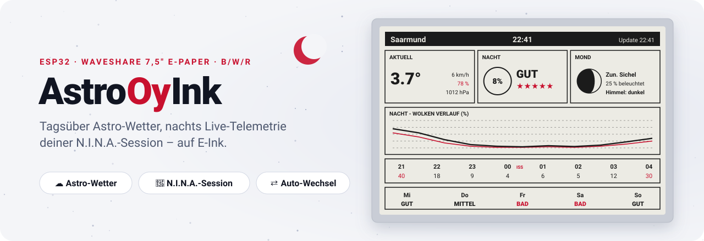
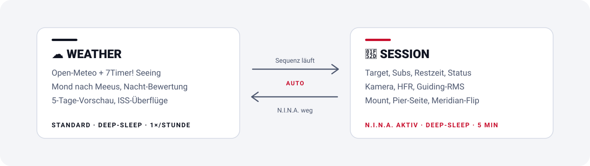
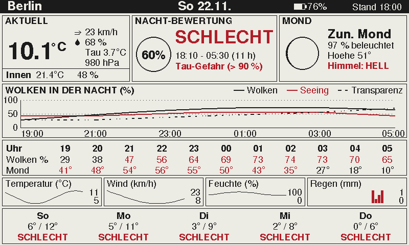
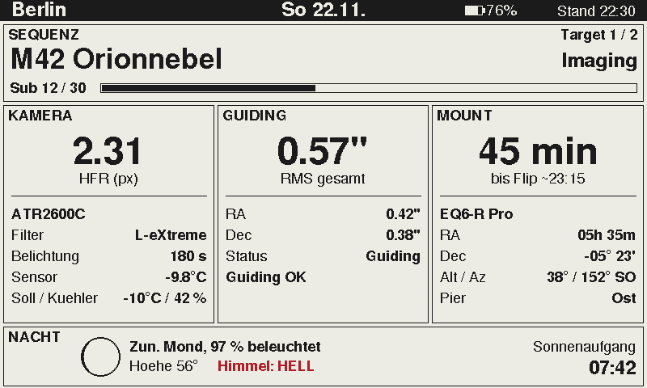
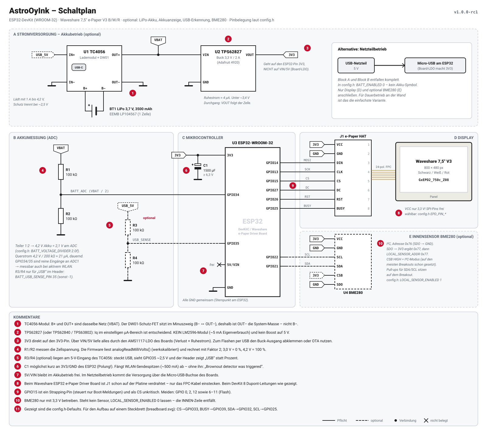
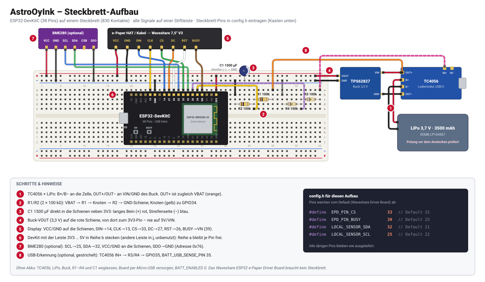

<p align="center">
  <picture>
    <source media="(prefers-color-scheme: dark)" srcset="docs/images/hero-dark.svg">
    <source media="(prefers-color-scheme: light)" srcset="docs/images/hero-light.svg">
    
  </picture>
</p>

<p align="center">
  
  
  
  
  
  <a href="LICENSE"></a>
</p>

<p align="center">
  <a href="#-die-zwei-modi"><b>Modi</b></a> ·
  <a href="#-funktionen"><b>Funktionen</b></a> ·
  <a href="#-hardware"><b>Hardware</b></a> ·
  <a href="#-stromversorgung"><b>Strom</b></a> ·
  <a href="INSTALL.md"><b>Installation</b></a> ·
  <a href="#%EF%B8%8F-konfiguration"><b>Konfiguration</b></a> ·
  <a href="#%EF%B8%8F-roadmap"><b>Roadmap</b></a> ·
  <a href="CONTRIBUTING.md"><b>Mitmachen</b></a>
</p>

<p align="center">
  <b>Ein E-Ink-Display an der Wand, das weiß, ob heute Nacht etwas geht – und was gerade am Teleskop passiert.</b><br>
  Ein ESP32 mit Waveshare-7,5″-E-Paper zeigt tagsüber das Astro-Wetter für deinen Standort.<br>
  Sobald <a href="https://nighttime-imaging.eu/">N.I.N.A.</a> eine Sequenz fährt, wechselt es von selbst auf Live-Telemetrie deiner Session.
</p>

---

## 🔁 Die zwei Modi

<p align="center">
  <picture>
    <source media="(prefers-color-scheme: dark)" srcset="docs/images/modi-dark.svg">
    
  </picture>
</p>

Ein Gerät, zwei Code-Pfade. Zu Beginn jedes Zyklus prüft AstroOyInk, ob die
N.I.N.A. Advanced API erreichbar ist **und** eine Sequenz läuft.

| | ☁️ **WEATHER** | 🔭 **SESSION** |
|---|---|---|
| **Wann** | Standard – immer, wenn keine Session läuft | N.I.N.A. erreichbar und Sequenz aktiv |
| **Quellen** | Open-Meteo, 7Timer!, Mond lokal | N.I.N.A. Advanced API v2 (Port 1888) |
| **Takt** | stündlich, dazwischen Deep-Sleep | alle 5 min, dazwischen Deep-Sleep |
| **Zurück** | – | automatisch, sobald N.I.N.A. weg ist |

### ☁️ WEATHER

<p align="center">
  
  <br><sub>Pixelgenaue Vorschau (<code>tools/preview</code>) – Waveshare 7,5″ V3, Schwarz/Weiß/Rot</sub>
</p>

### 🔭 SESSION

<p align="center">
  
  <br><sub>Pixelgenaue Vorschau mit Beispieldaten einer laufenden Sequenz</sub>
</p>

## ✨ Funktionen

<table>
<tr>
<td width="50%" valign="top">

### ☁️ WEATHER-Modus

- ⭐ **Nacht-Bewertung** aus gewichteter Wolkendecke<br><sub>Low 0,5 · Mid 0,3 · High 0,2 → GUT / MITTEL / SCHLECHT</sub>
- 🕘 **Echtes Nachtfenster** – Sonnenuntergang +2 h bis Sonnenaufgang −2 h
- 🌙 **Mond nach Meeus**, lokal berechnet: Phase, Beleuchtung, Höhe, Himmelsaufhellung
- 📈 **Wolken-Verlauf** der Nacht (gewichteter Wolken-Score)
- 🪐 **Seeing & Transparenz** von 7Timer! als Kurven im Chart
- 🌙 **Mondhöhe je Nachtstunde** in der Stundentabelle, ab 30° rot
- ⚠️ **Wind- und Tau-Warnung** ab 25 km/h bzw. 90 % Feuchte
- 📊 Mini-Charts (Temp, Wind, Feuchte, Regen) und **6-Tage-Vorschau**

</td>
<td width="50%" valign="top">

### 🔭 SESSION-Modus

- 📋 **Sequenz:** Target groß, Target i/n, Status, Fortschrittsbalken Sub i/n
- 📷 **Kamera:** HFR des letzten Bildes groß, dazu Name, Filter, Belichtung,
  Sensor-Temperatur ist/soll und Kühlerleistung
- 🧭 **Guiding:** RMS gesamt groß, dazu RA/Dec und „OK / unruhig / verloren“
- 🌐 **Mount:** Zeit bis zum Meridian-Flip groß mit ungefährer Uhrzeit, dazu RA/Dec, Alt/Az, Pier-Seite
- 🌙 **Nacht:** Mondphase, -höhe und Himmelsaufhellung (lokal berechnet), Sonnenaufgang
- 🚨 **Warnungen** rot hervorgehoben: RMS ≥ 1,0″, Flip < 10 min, Höhe < 20°,
  Sensor > 1,5 K vom Soll oder Kühler aus, Slewing, Pause
- 📡 **Auto-Discovery** – findet den N.I.N.A.-PC im Heimnetz selbst

### 🧰 Rund ums Gerät

- 📶 **WiFiManager** – Captive Portal, alle Einstellungen ohne Re-Flash
- 📤 **OTA-Updates** – 30-s-Fenster nach jedem WLAN-Connect
- 🌡️ **BME280** – Innentemperatur, Feuchte, Luftdruck
- 🔋 **Akkubetrieb** mit Low-Iq-Buck – rechnerisch Monate pro Ladung
- 🪫 **Akkuanzeige** im Header, optional mit USB-Erkennung
- 💤 **Deep-Sleep** zwischen den Updates, in beiden Modi

</td>
</tr>
</table>

> [!NOTE]
> **Drei Farben, kein Grün.** Das Panel kann nur Schwarz, Weiß und Rot. „Gute“
> Zustände zeigt AstroOyInk deshalb mit Sternen, Rahmen und fetter Schrift –
> Rot ist für Warnungen reserviert. Für reine B/W-Panels gibt es
> `DISPLAY_HAS_RED 0`.

## 🔩 Hardware

| Komponente | Modell | Hinweis |
|---|---|---|
| Mikrocontroller | ESP32-WROOM-32 | getestet mit dem Waveshare ESP32 e-Paper Driver Board |
| Display | Waveshare **7,5″ E-Paper V3**, B/W/R, 800×480 | Treiber `GxEPD2_750c_Z08` |
| Stromversorgung | USB 5 V **oder** LiPo-Akku | siehe [Stromversorgung](#-stromversorgung) |
| *optional* | BME280 (I²C) | Innenklima im AKTUELL-Block |
| *optional* | Bilderrahmen 7×5″ | für die Wand |

> [!TIP]
> Ein voller Drei-Farben-Refresh dauert auf dem V3-Panel **25–30 Sekunden**.
> Das Flackern dabei ist normal.

### Pinbelegung Display

| Signal | BUSY | RST | DC | CS | SCK | MOSI |
|---|---|---|---|---|---|---|
| GPIO | 25 | 26 | 27 | 15 | 13 | 14 |

### Schaltplan und Steckbrett-Aufbau

Vollständig kommentiert, inklusive Akkubetrieb, Akkuanzeige, USB-Erkennung
und BME280 (optionale Teile gestrichelt). Der Steckbrett-Aufbau passt auf
**ein** Brett und nutzt dafür vier andere Pins (CS 33, BUSY 39, SDA 32,
SCL 25) – Details in [INSTALL.md](INSTALL.md#2-verkabelung).

<p align="center">
  <a href="docs/images/schaltplan.svg"></a>
</p>
<p align="center">
  <a href="docs/images/breadboard.svg"></a>
</p>

Erzeugt mit `python3 tools/make_wiring_svgs.py docs/images`.

## 🔋 Stromversorgung

### Netzteil

USB 5 V direkt am Board. Mehr braucht es nicht – die Akkuanzeige dann mit
`BATT_ENABLED 0` abschalten.

### Akku – Referenzaufbau

Gleiche Bauteile und Schaltung wie beim Türschild-Projekt **DoorSign**, dort
gemessen und im Dauereinsatz. Über die Laufzeit entscheidet nicht der ESP32,
sondern der **Ruhestrom der Stromversorgung**.

```
USB-C ──> TC4056 ──> LiPo 3,7 V ──┬──> TPS62827 Buck ──> 3,3 V ──> ESP32 3V3-Pin
          Lademodul  3500 mAh     │    Iq ~4 µA              │
                                  │                          └── 1500 µF Elko ── GND
                                  └── 100 kΩ ──┬── GPIO34
                                               └── 100 kΩ ── GND
```

| Bauteil | Typ | Warum dieser |
|---|---|---|
| Lademodul | TC4056, USB-C, 1 A | Ladeschluss 4,2 V, Tiefentladeschutz integriert |
| Zelle | LiPo 3,7 V – EEMB LP104567, 3500 mAh | Kapazität nach gewünschter Laufzeit |
| Spannungswandler | **TPS62827** Buck 3,3 V / 2 A (Adafruit 4920) | Ruhestrom ~4 µA, liefert 3,3 V direkt |
| Pufferelko | 1500 µF zwischen 3V3 und GND am ESP32 | fängt WLAN-Spitzen (~500 mA) ab |
| Spannungsteiler | 2 × 100 kΩ, Akku+ → GPIO34 → GND | Akkuanzeige, zieht dauerhaft ~20 µA |

> [!IMPORTANT]
> **Die 3,3 V gehen auf den `3V3`-Pin, nicht auf `VIN`/5V.** Über `VIN` liefe der
> Strom durch den AMS1117-LDO des Boards, der Spannung verheizt und selbst
> Ruhestrom zieht. Am Waveshare-Board muss dafür nichts ausgelötet werden: Der
> LDO ist umgangen, und der USB-Chip hängt an USB-5 V, die im Akkubetrieb fehlt.

#### Ersatzteile, Grenzen und USB-Erkennung

**Ersatz für den TPS62827:** entscheidend ist der Ruhestrom (Iq) im
einstelligen µA-Bereich, 3,3 V direkt am Ausgang und ein LiPo-tauglicher
Eingang (3,0–4,2 V). Geeignet sind z. B. TPS62827, TPS62840 oder TPS63802.
**Ungeeignet sind LM2596-Module** („3 A Step-Down“, 150 kHz) – ~5 mA
Eigenverbrauch, das Vielfache des schlafenden ESP32. Auch kein Boost auf 5 V.

**Grenze nach unten:** Unter ~3,4 V geht der Buck in Durchgang, der Ausgang
folgt der Zelle. WLAN braucht stabile ~3,0 V – nutzbar ist die Zelle also bis
etwa 3,0 V, die Anzeige steht dort auf 0 %. Die Messung nutzt
`analogReadMilliVolts()` mit Werkskalibrierung und bleibt dadurch auch bei
sinkender Versorgungsspannung korrekt.

**USB-Erkennung (optional):** Die Akkuspannung allein verrät nicht, ob
geladen wird. Wer im Header „USB“ sehen möchte, setzt einen zweiten Teiler an
den 5-V-Eingang des TC4056 – `USB 5V → 100 kΩ → GPIO35 → 100 kΩ → GND` – und
trägt in `config.h` `BATT_USB_SENSE_PIN 35` ein.

**Flashen per USB:** Während das Board am USB-Kabel hängt, speisen Board-LDO
und Buck gleichzeitig in 3V3. Sicherer ist es, dafür den Buck-Ausgang
abzuklemmen – oder per OTA zu flashen.

**Brownout:** `Brownout detector was triggered` im Serial Monitor heißt, die
Versorgung schafft die WLAN-Spitzen nicht – Pufferelko prüfen.

### Laufzeit

> [!NOTE]
> Die Zahlen sind **gerechnet, nicht gemessen**. Der Ruhestrom stammt aus der
> DoorSign-Messung mit identischer Versorgung, die Wake-Kosten sind geschätzt.

| Posten | Annahme | mAh/Tag |
|---|---|---|
| Ruhestrom | 0,4 mA (DoorSign gemessen) + 0,02 mA Teiler | ~10 |
| WEATHER-Wakes | 24 × (~10 s WLAN à 120 mA + 30 s Refresh à ~50 mA) ≈ 24 × 0,75 mAh | ~18 |
| **Summe** | | **~28** |

Rechnerisch reichen 3500 mAh (~90 % nutzbar) damit für **rund 110 Tage** im
WEATHER-Betrieb. DoorSign hat in der Praxis nur gut ein Drittel seiner
eigenen Hochrechnung erreicht – realistisch sind daher eher **1–2 Monate**.

Eine **Session-Nacht** (8 h, Update alle 5 min) kostet zusätzlich etwa
**60 mAh**, also ungefähr zwei Tage WEATHER-Betrieb.

Was die Firmware dafür tut:

- **Deep-Sleep auch im SESSION-Modus** zwischen den 5-Minuten-Updates
- **WLAN aus vor dem Refresh** – die Daten sind dann schon geholt, der 30-s-Refresh läuft ohne Funk
- **OTA-Fenster nur beim Kaltstart** – für ein Update kurz RST drücken

## 🚀 Schnellstart

Die ausführliche Anleitung steht in **[INSTALL.md](INSTALL.md)**. Kurzfassung:

1. **Arduino IDE 2.x** und das **ESP32-Boardpaket** (≥ 2.0.14) installieren
2. Bibliotheken über den Library Manager: `GxEPD2`, `Adafruit GFX`, **`ArduinoJson 7.x`**, `WiFiManager` (tzapu)
3. Board **„ESP32 Dev Module“** wählen, `AstroOyInk.ino` öffnen und flashen
4. Mit dem WLAN **`AstroOyInk-XXXXXX`** verbinden (der Name steht auch auf dem Display) und im Portal WLAN, Standort und optional den N.I.N.A.-Host eintragen (leer = automatische Suche)
5. Fertig – das erste Dashboard erscheint nach etwa einer Minute

## ⚙️ Konfiguration

Alles lässt sich im **WiFiManager-Portal** einstellen. Die Defaults für die
Ersteinrichtung stehen in `config.h`:

```cpp
// Standort
#define LOCATION_NAME   "Berlin"
#define LOCATION_LAT    52.5200f
#define LOCATION_LON    13.4050f
#define TIMEZONE_POSIX  "CET-1CEST,M3.5.0,M10.5.0/3"

// Update-Intervalle
#define REFRESH_INTERVAL_S          3600UL  // WEATHER: 1 Stunde, Deep-Sleep
#define SESSION_REFRESH_INTERVAL_S   300UL  // SESSION: 5 Minuten, Deep-Sleep

// Display: 1 = Schwarz/Weiss/Rot (Standard), 0 = nur B/W
#define DISPLAY_HAS_RED  1

// Guiding-Warnschwelle im SESSION-Modus
#define GUIDING_WARN_RMS_ARCSEC  1.0f

// Akkuanzeige (siehe Stromversorgung)
#define BATT_ENABLED         1
#define BATT_ADC_PIN         34
#define BATT_VOLTAGE_DIVIDER 2.0f
#define BATT_USB_SENSE_PIN   -1     // 35 = USB-Erkennung verbaut
```

### SESSION-Modus aktivieren

1. In N.I.N.A. das Plugin **Advanced API** installieren und aktivieren (Port 1888).
2. Das Feld **„N.I.N.A. Host“** im Portal **leer lassen** – AstroOyInk findet den
   N.I.N.A.-PC dann selbst (siehe unten). Wer lieber einen festen Host will,
   trägt Hostname oder IP ein, z. B. `nina-pc.local` oder `192.168.1.42`.
3. Sequenz starten. Beim nächsten Zyklus wechselt das Display von selbst.

### 📡 Auto-Discovery

Ist kein Host eingetragen, sucht AstroOyInk den N.I.N.A.-PC selbst:

1. Zuerst wird die **zuletzt gefundene Adresse** (im Flash gespeichert) geprüft – das passiert bei jedem Aufwachen und kostet kaum Zeit.
2. Antwortet sie nicht, werden alle Adressen des **eigenen /24-Netzes** auf offenen Port 1888 geprüft (8 parallele Verbindungsversuche, ca. 8 s).
3. Jeder Treffer wird per `GET` an die Advanced API bestätigt, bevor er übernommen wird.

Der Netz-Scan läuft nur von **1 h vor Sonnenuntergang bis 1 h nach Sonnenaufgang**, damit tagsüber kein Akku verloren geht. Nach einem Kaltstart sind die Sonnenzeiten noch unbekannt, dann wird immer gesucht. Mit `NINA_AUTO_DISCOVERY 0` in `config.h` ist die Suche aus, `NINA_SCAN_MARGIN_S` ändert den Puffer.

## 🖼️ Display-Layout

### WEATHER-Modus (800 × 480)

```
┌─ Saarmund ────────────── 22:41 ────────── [### ] 72 %  Update 22:41 ─┐
│ AKTUELL            │ NACHT-BEWERTUNG       │ MOND                    │
│  3.7 C    6 km/h   │  ( 8% )  GUT          │  (  Zun. Sichel         │
│           78 %     │          *****        │     25 % beleuchtet     │
│  IN: 21 C  45 %    │  Nacht 22:17-03:54    │     Himmel: dunkel      │
├────────────────────┴───────────────────────┴─────────────────────────┤
│ WOLKEN IN DER NACHT (%)        Wolken / Seeing / Transparenz         │
├──────────────────────────────────────────────────────────────────────┤
│ Uhr / Wolken % / Mond (Hoehe je Nachtstunde)                         │
├──────────────────────────────────────────────────────────────────────┤
│ Temp │ Wind │ Feuchte │ Regen      (Mini-Charts 24 h)                │
├──────────────────────────────────────────────────────────────────────┤
│   Mi      Do      Fr      Sa      So      Mo    (Tmin/Tmax/Nacht)  │
└──────────────────────────────────────────────────────────────────────┘
```

### SESSION-Modus (800 × 480)

```
┌─ Saarmund ─────────────── So 22.11. ─────── [### ] 72 %  Stand 23:12 ─┐
│ SEQUENZ                                                  Target 1 / 3 │
│ M31-LRGB                                                      Imaging │
│ Sub 42 / 120  [##############..............................]          │
├───────────────────────┬───────────────────────┬───────────────────────┤
│ KAMERA                │ GUIDING               │ MOUNT                 │
│        2.10           │        0.57"          │       1h 12m          │
│      HFR (px)         │      RMS gesamt       │  bis Flip ~00:25      │
│ ZWO ASI2600MM         │ RA              0.42" │ EQ6-R Pro             │
│ Filter              L │ Dec             0.38" │ RA          00h 43m   │
│ Belichtung      180 s │ Status       Guiding  │ Dec         +41° 16'  │
│ Sensor         -9.8°C │ Guiding OK            │ Alt / Az  58° / 112°  │
│ Soll/Kuehler -10°/42% │                       │ Pier              Ost │
├───────────────────────┴───────────────────────┴───────────────────────┤
│ NACHT  ( ) Zun. Mond, 69 % beleuchtet             Sonnenaufgang 07:42 │
│            Hoehe 12°   Himmel: mittel                                 │
└───────────────────────────────────────────────────────────────────────┘
```

## 🗂️ Projektstruktur

```
AstroOyInk/
├── AstroOyInk.ino            # setup() / loop() / doCycle() mit Modus-Switch
├── config.h                  # Standort, Pins, Schwellwerte, Defaults
├── src/                      # wird von der Arduino IDE rekursiv kompiliert
│   ├── common/               # Datentypen, Zeit, Astro-Logik, Mond, Akku,
│   │                         # NVS-Config, OTA, BME280
│   ├── data_sources/         # Open-Meteo, 7Timer!, N.I.N.A. (+ open-notify, derzeit aus)
│   ├── modes/                # mode_state_machine: WEATHER ↔ SESSION
│   └── rendering/            # GxEPD2, Wetter- und Session-Dashboard
├── tests/                    # Host-Tests mit g++, ohne ESP32
├── tools/                    # Generatoren für README-Grafiken, Schaltplan, Vorschau
└── docs/images/              # Hero, Modus-Grafik, Display-Vorschau, Schaltplan
```

## 🧪 Tests

```bash
cd tests
./build_and_run.sh
```

Prüft die Astro-Bewertung (8 Szenarien) und die Mondberechnung gegen bekannte
Mondereignisse 2026 – komplett auf dem Rechner, ohne Hardware.

## 🗺️ Roadmap

| # | Feature | Status |
|---|---|---|
| 1 | 🔋 Akkuanzeige im Header | ✅ |
| 2 | 📶 WiFiManager (Captive Portal) | ✅ |
| 3 | 📤 OTA-Updates | ✅ |
| 4 | 🌡️ Lokaler Sensor (BME280) | ✅ |
| 5 | 🪐 7Timer! Seeing & Transparenz | ✅ |
| 6 | 🛰️ ISS-Überflüge | ⏸️ pausiert – open-notify hat die Überflug-Vorhersage abgeschaltet |
| 7 | 📷 Screenshot-Export auf SD | ❌ gestrichen |
| 8 | 🔭 SESSION-Modus (N.I.N.A. Advanced API) | ✅ |

Die Versionshistorie steht im [CHANGELOG.md](CHANGELOG.md).

## 🤔 Warum „AstroOyInk“?

Der Name verbindet den jiddischen Ausruf **Oy Vey** – sinngemäß *„Oh nein.
Nicht schon wieder.“* – mit **Ink** für die E-Ink-Technik. „Oy Vey“ beschreibt
erstaunlich präzise den Gemütszustand vieler Astrofotografen:

> meist kurz nach erfolgreichem Polar Alignment,
> während des Meridian Flips oder genau in dem Moment,
> 6 h nach Sessionstart, wenn du merkst, dass du die Tauheizung vergessen hast,
> in dem trotz perfekter Wettervorhersage Wolken aufziehen.

AstroOyInk steht für die besondere Mischung aus Technik, Hoffnung, Schlafmangel
und leichtem Wahnsinn, die Astrofotografie ausmacht. Oder kürzer:
**ein kleines E-Paper-Astrodisplay für Menschen, die „klarer Himmel“ eher für
ein theoretisches Konzept halten.**

### Vorgeschichte: AstroWeatherEPD

AstroOyInk ist aus dem unveröffentlichten Vorgänger **AstroWeatherEPD v1.0**
hervorgegangen, in dem der WEATHER-Modus entstanden ist. Den Weg dorthin
dokumentiert das [CHANGELOG.md](CHANGELOG.md). AstroOyInk ist die offizielle Linie.

## 🙏 Credits

- **Autor:** Kai Linde – [github.com/lindekai](https://github.com/lindekai)
- **Community:** Dark Matters Discord
- **Daten:** [Open-Meteo](https://open-meteo.com), [7Timer!](https://www.7timer.info)
- **Software:** [N.I.N.A.](https://nighttime-imaging.eu/) mit [Advanced API](https://github.com/christian-photo/ninaAPI), [GxEPD2](https://github.com/ZinggJM/GxEPD2), [Adafruit GFX](https://github.com/adafruit/Adafruit-GFX-Library), [ArduinoJson](https://arduinojson.org), [WiFiManager](https://github.com/tzapu/WiFiManager), [Adafruit BME280](https://github.com/adafruit/Adafruit_BME280_Library)

Fragen, Ideen oder Fotos von deinem Setup? Gerne als [Issue](https://github.com/lindekai/AstroOyInk/issues).

## 📄 Lizenz

[MIT](LICENSE) © 2026 Kai Linde. Für Open-Meteo-Daten gelten die Bedingungen
von <https://open-meteo.com>.

---

<p align="center"><sub>N.I.N.A. ist ein eigenständiges Open-Source-Projekt. Dieses Projekt steht in keiner offiziellen Verbindung zu N.I.N.A. oder Waveshare.</sub></p>
