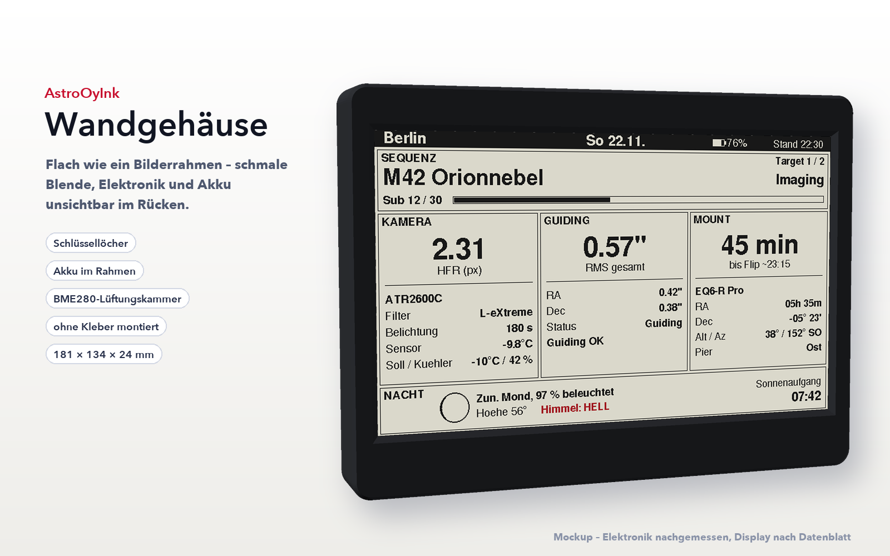
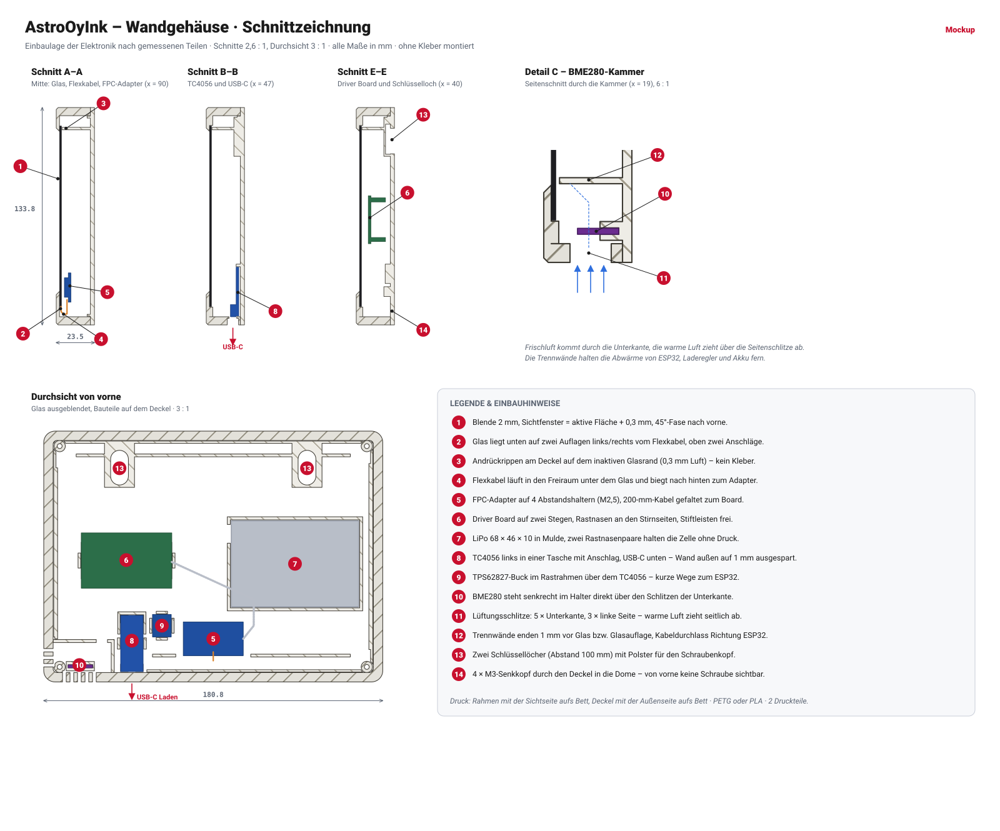

# Gehäuse für AstroOyInk (3D-Druck)

Zwei Gehäuse für dieselbe Elektronik – parametrisch in OpenSCAD, fertige STLs
liegen in [`stl/`](stl/). Beide kommen **ohne Kleber** aus: Rastnasen,
Niederhalter-Rippen, Presspassung und Schrauben.

> **Status: Mockup.** Die Elektronik ist nachgemessen, das Display nach
> Datenblatt. Der erste Probedruck steht noch aus – Passungen ggf. über `tol`
> in `common.scad` anpassen.

## Tischgehäuse


Flacher Sockel mit der kompletten Elektronik. Das Glas steckt nur unten in
einem um **15°** geneigten Schlitz, oben ist alles frei. Der Schlitz ist genau
so tief wie der inaktive untere Rand des Panels (9,3 mm) – sichtbar bleibt nur
die aktive Fläche.


| | |
|---|---|
| Außenmaß | 200 × 84 × 26,4 mm (ohne Display) |
| Druckteile | `tisch_sockel.stl` (Oberseite aufs Bett), `tisch_boden.stl` (flach) |
| Anschluss | 1 × USB-C (Laden) hinten |
| BME280 | eigene Kammer vorne links, Schlitze in Seitenwand und Boden |

## Wandgehäuse



Flach wie ein Bilderrahmen. Das Glas liegt vorne an der 2-mm-Blende an, Rippen
am Rückdeckel drücken von hinten auf den inaktiven Rand. Die Elektronik sitzt
komplett auf dem Deckel.



| | |
|---|---|
| Außenmaß | 180,8 × 133,8 × 23,5 mm |
| Druckteile | `wand_rahmen.stl` (Sichtseite aufs Bett), `wand_deckel.stl` (Außenseite aufs Bett) |
| Anschluss | 1 × USB-C (Laden) an der Unterkante |
| Aufhängung | 2 Schlüssellöcher, Abstand 100 mm (Schraube mit Kopf ≤ 9 mm) |
| BME280 | eigene Kammer unten links, 5 Schlitze unten, 3 an der linken Seite |

## Teileliste

| Teil | Tisch | Wand | Hinweis |
|---|---|---|---|
| M3 × 8 Senkkopf, selbstschneidend | 4 | 4 | Bodenplatte bzw. Deckel |
| M2,5 × 6, selbstschneidend | 4 | 4 | FPC-Adapterplatine |
| FPC-Verlängerung 24-pol. + Flachbandkabel | 1 | 1 | Adapter 32 × 18 mm, Kabel 100–200 mm |
| Gummifüße Ø 10 mm | 4 | – | in die Mulden der Bodenplatte |

Elektronik wie im [Schaltplan](../../docs/images/schaltplan.svg): Waveshare ESP32
e-Paper Driver Board Rev 3, Waveshare 7,5″ V3 (B/W/R), LiPo EEMB LP104567,
TC4056 USB-C, TPS62827-Buck, BME280.

### Nachgemessene Maße (`common.scad`)

| Bauteil | Maß | Besonderheit |
|---|---|---|
| Driver Board Rev 3 | 48,3 × 29,5, 14 hoch | Stiftleisten 9 mm nach unten (bleiben dran), USB-C mittig an der Schmalseite |
| Panel-Flexkabel | 15 breit, 25 lang | mittig |
| FPC-Adapter | 32 × 18 × 4 | Löcher Ø 3, Abstand 25 × 11 |
| LiPo | 68 × 46 × 10 | JST-Kabel an der Schmalseite |
| TC4056 | 30 × 12, USB-C 4 hoch | Pads gegenüber der Buchse |
| Buck | 10 × 12 × 3 | direkt angelötet |
| BME280 | 13 × 11 | 4 Pins an der Schmalseite |

## Drucken

- PETG oder PLA, 0,2 mm Schichthöhe, 3 Wände, 20 % Infill.
- Keine Stützen nötig. Beim Tischsockel liegt die Oberseite auf dem Bett, der
  Schlitz zeigt also nach unten – die Einführfase sorgt für eine saubere Kante.
- Alle Teile passen auf ein 250 × 210 mm Bett.

## Zusammenbau

**Tisch**
1. Elektronik auf der Bodenplatte einsetzen: Akku in die Mulde, TC4056 und Buck
   in die Rastrahmen klicken, Driver Board auf die Stege, FPC-Adapter mit
   4 × M2,5 verschrauben, BME280 in den Schlitzhalter stecken.
2. Flachbandkabel vom Adapter zum Board stecken, Rest flach über den Akku legen.
3. Sockel aufsetzen, Panel-Flexkabel durch den Schlitzdurchlass zum Adapter
   führen und einstecken, Bodenplatte mit 4 × M3 von unten verschrauben.
4. Glas in den Schlitz stellen – es liegt auf den beiden Auflagen neben dem Kabel.

**Wand**
1. Glas mit der Sichtseite nach unten in den Rahmen legen, Flexkabel nach unten.
2. Elektronik auf dem Deckel einsetzen (wie oben), Panel-Flexkabel am Adapter einstecken.
3. Deckel aufsetzen – die Rippen drücken das Glas an die Blende – und mit 4 × M3 verschrauben.

Zum Flashen per Kabel die Bodenplatte bzw. den Deckel abnehmen; im Alltag reicht OTA.

## Anpassen und neu erzeugen

Die wichtigsten Parameter stehen oben in den `.scad`-Dateien, z. B. `neigung`
(Tisch), `tol` (Passungen, `common.scad`), Wandstärken und die Lage der Bauteile.

```bash
hardware/gehaeuse/export_stl.sh                  # alle STLs nach hardware/gehaeuse/stl/
python3 tools/make_gehaeuse_mockups.py tisch wand  # Hero-Bilder und Schnittzeichnungen
```

Beides braucht OpenSCAD (Pfad per `OPENSCAD`, Standard: `OpenSCAD-2021.01.app`),
die Mockups zusätzlich Python mit PIL und numpy.
