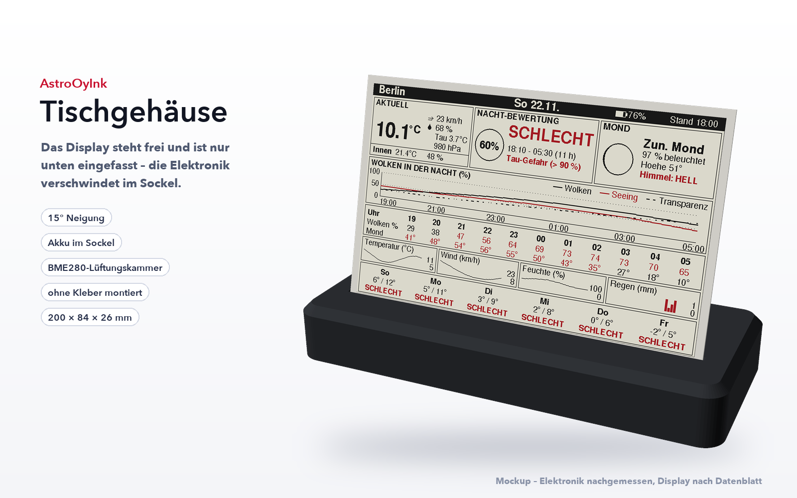
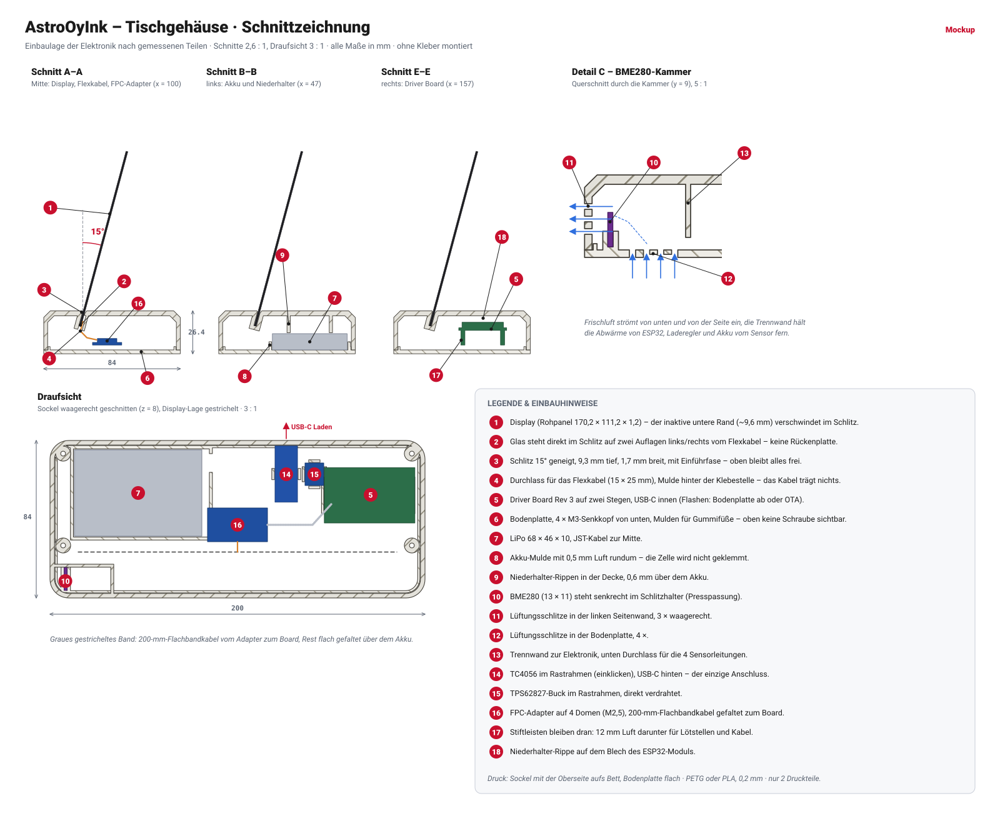

# Gehäuse für AstroOyInk (3D-Druck)

Zwei Gehäuse für dieselbe Elektronik – parametrisch in OpenSCAD, fertige STLs
liegen in [`stl/`](stl/). Beide kommen **ohne Kleber** aus: Rastnasen,
Niederhalter-Rippen, Presspassung und Schrauben.

> **Status:** Das Tischgehäuse ist in der aktuellen, kompakten Version gedruckt
> und im Einsatz getestet – es funktioniert. (Beim ersten Probedruck stieß die
> BME-Kammer noch auf den Zentrierrand der Bodenplatte, siehe
> [Kollisionsprüfung](#kollisionsprüfung).) Beim Wandgehäuse passte nach dem
> ersten Druck der Rahmen; der Deckel wurde überarbeitet (Ladeelektronik nach
> links, BME-Kammer niedriger mit Kabeldurchlass, USB-C-Wand ausgespart) – dafür
> ist auch der Rahmen neu zu drucken (USB-Loch an neuer Stelle).
> Passungen ggf. über `tol` in `common.scad` anpassen.

## Tischgehäuse



Flacher Sockel mit der kompletten Elektronik. Das Glas steckt nur unten in
einem um **15°** geneigten Schlitz, oben ist alles frei. Der Schlitz ist genau
so tief wie der inaktive untere Rand des Panels (9,3 mm) – sichtbar bleibt nur
die aktive Fläche.



| | |
|---|---|
| Außenmaß | 184 × 68 × 21,4 mm (ohne Display) |
| Druckteile | `tisch_sockel.stl` (Oberseite aufs Bett), `tisch_boden.stl` (flach) |
| Anschluss | 1 × USB-C (Laden) hinten |
| BME280 | eigene Kammer hinten rechts, Schlitze in Rückwand, rechter Seitenwand und Boden |
| Beschriftung | Unterseite der Bodenplatte, 0,6 mm vertieft: Projektname, Version (`version` in `gehaeuse_tisch.scad`), Autor, Community, Lizenz |

## Wandgehäuse


Flach wie ein Bilderrahmen. Das Glas liegt vorne an der 2-mm-Blende an, Rippen
am Rückdeckel drücken von hinten auf den inaktiven Rand. Die Elektronik sitzt
komplett auf dem Deckel.


| | |
|---|---|
| Außenmaß | 180,8 × 133,8 × 23,5 mm |
| Druckteile | `wand_rahmen.stl` (Sichtseite aufs Bett), `wand_deckel.stl` (Außenseite aufs Bett) |
| Anschluss | 1 × USB-C (Laden) an der Unterkante links, Wand vor der Buchse außen auf 1 mm ausgespart |
| Aufhängung | 2 Schlüssellöcher, Abstand 100 mm, 15 mm unter der Oberkante (Schraube mit Kopf ≤ 9 mm) |
| Bohrschablone | [`bohrschablone_wand.pdf`](bohrschablone_wand.pdf) – A4, mit 100 % drucken, Kontrollstrecke nachmessen |
| BME280 | eigene Kammer unten links, 5 Schlitze unten, 3 an der linken Seite, Kabeldurchlass Richtung ESP32 |
| Ladeelektronik | links auf der ESP-Seite: TC4056 in einer Tasche mit Anschlag rechts neben der BME-Kammer, Buck darüber |

## Teileliste

| Teil | Tisch | Wand | Hinweis |
|---|---|---|---|
| M3 × 8 Senkkopf, selbstschneidend | 4 | 4 | Bodenplatte bzw. Deckel |
| M2,5 × 6, selbstschneidend | 4 | 4 | FPC-Adapterplatine |
| FPC-Verlängerung 24-pol. + Flachbandkabel | 1 | 1 | Adapter 32 × 18 mm, Kabel 100–200 mm |
| Gummifüße Ø 10 mm | 4 | – | in die Mulden der Bodenplatte |

Elektronik wie im [Schaltplan](../../docs/images/schaltplan.svg): Waveshare ESP32
e-Paper Driver Board Rev 3, Waveshare 7,5″ V3 (B/W/R), LiPo EEMB LP104567,
TC4056 USB-C, TPS62827-Buck, BME280.

### Nachgemessene Maße (`common.scad`)

| Bauteil | Maß | Besonderheit |
|---|---|---|
| Driver Board Rev 3 | 48,3 × 29,5, 14 hoch | Stiftleisten 9 mm nach unten (bleiben dran), USB-C mittig an der Schmalseite |
| Panel-Flexkabel | 15 breit, 25 lang | mittig |
| FPC-Adapter | 32 × 18 × 4 | Löcher Ø 3, Abstand 25 × 11 |
| LiPo | 68 × 46 × 10 | JST-Kabel an der Schmalseite |
| TC4056 | 30 × 12, USB-C 4 hoch | Pads gegenüber der Buchse |
| Buck | 10 × 12 × 3 | direkt angelötet |
| BME280 | 13 × 11 | 4 Pins an der Schmalseite |

## Drucken

- PETG oder PLA, 0,2 mm Schichthöhe, 3 Wände, 20 % Infill.
- Keine Stützen nötig. Beim Tischsockel liegt die Oberseite auf dem Bett, der
  Schlitz zeigt also nach unten – die Einführfase sorgt für eine saubere Kante.
- Alle Teile passen auf ein 250 × 210 mm Bett.

## Zusammenbau

**Tisch**
1. Elektronik auf der Bodenplatte einsetzen: Akku links in die Mulde, TC4056
   und Buck in die Rastrahmen klicken, Driver Board rechts vorne auf die Stege,
   FPC-Adapter mittig mit 4 × M2,5 verschrauben, BME280 in den Halter in der
   Kammer hinten rechts stecken (die Kammerwände sind Teil der Bodenplatte,
   die Sensorleitungen laufen unten durch die linke Kammerwand).
2. Flachbandkabel vom Adapter zum Board stecken, Rest flach zwischen Adapter und Board falten.
3. Sockel aufsetzen, Panel-Flexkabel durch den Schlitzdurchlass zum Adapter
   führen und einstecken, Bodenplatte mit 4 × M3 von unten verschrauben.
4. Glas in den Schlitz stellen – es liegt auf den beiden Auflagen neben dem Kabel.

**Wand**
1. Glas mit der Sichtseite nach unten in den Rahmen legen, Flexkabel nach unten.
2. Elektronik auf dem Deckel einsetzen: Akku rechts in die Mulde, Driver Board
   oben links auf die Stege, TC4056 mit der Buchse nach unten in die Tasche
   schieben bis an den Anschlag und einrasten, Buck darüber in den Rastrahmen,
   FPC-Adapter mit 4 × M2,5, BME280 in den Halter der Kammer unten links
   (Sensorkabel durch den Durchlass oben rechts in der Kammerwand).
   Panel-Flexkabel am Adapter einstecken.
3. Deckel aufsetzen – die Rippen drücken das Glas an die Blende – und mit 4 × M3 verschrauben.
4. [Bohrschablone](bohrschablone_wand.pdf) in Originalgröße drucken, mit der
   Wasserwaage ausrichten und die zwei Punkte bohren. Rund- oder Linsenkopfschrauben
   (Schaft 3,5–4 mm) so eindrehen, dass der Kopf ca. 3 mm vor der Wand steht,
   Gerät mit den runden Öffnungen über die Köpfe hängen und nach unten rutschen lassen.
   Neu erzeugen: `python3 tools/make_bohrschablone.py`.

Zum Flashen per Kabel die Bodenplatte bzw. den Deckel abnehmen; im Alltag reicht OTA.

## Kollisionsprüfung

```bash
hardware/gehaeuse/pruefe_kollision.sh        # Tisch
hardware/gehaeuse/pruefe_kollision.sh wand   # Wand
```

Schneidet jedes Paar aus Druckteilen (Sockel/Bodenplatte bzw. Rahmen/Deckel),
Display und Elektronik miteinander (`teil="kollision"` in der jeweiligen `.scad`). Reine
Flächenkontakte (Platine liegt auf Steg) sind erlaubt, jedes echte Volumen wird
mit Lage gemeldet. Nach jeder Änderung an Maßen oder Bauteillage laufen lassen,
bevor gedruckt wird.

## Anpassen und neu erzeugen

Die wichtigsten Parameter stehen oben in den `.scad`-Dateien, z. B. `neigung`
(Tisch), `tol` (Passungen, `common.scad`), Wandstärken und die Lage der Bauteile.

```bash
hardware/gehaeuse/export_stl.sh                  # alle STLs nach hardware/gehaeuse/stl/
python3 tools/make_gehaeuse_mockups.py tisch wand  # Hero-Bilder und Schnittzeichnungen
```

Beides braucht OpenSCAD (Pfad per `OPENSCAD`, Standard: `OpenSCAD-2021.01.app`),
die Mockups zusätzlich Python mit PIL und numpy.
